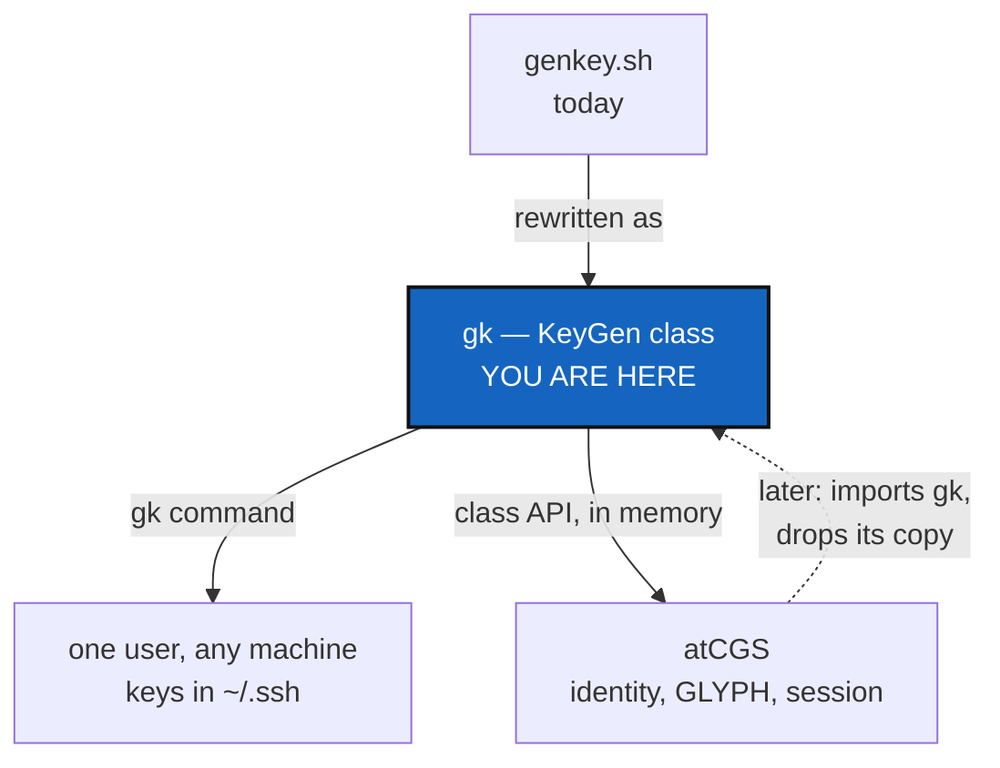

# KeyGenPackage — `gk`, one class that makes a user's ssh keys on any machine, and that atCGS can use

*Created: 2026-11-05*

*Revised: 2026-11-05 — made compatible with atCGS 1.7.1-alpha*

*Branch: 1-gk*

*Source: GitHub issue [flipoyo/sshKeyGen#1](https://github.com/flipoyo/sshKeyGen/issues/1) — "ergonomy and security - KeyGen Python Package"*

## Abstract — read this first

**The one-line version.** Replace `genkey.sh` with one Python class, shipped as
the package `gk`, that turns *one login and one password* into the same
identity on any machine — and let [atCGS](https://github.com/flipoyo/atCGS)
use that same class instead of keeping its own copy.

**What this document is.** A ticket. Nothing here has been built.

**Why it exists.** The issue asks for a UX target (README of 100 lines at most)
and a security target (the private key is protected by a passphrase derived from
a declared secret). Reading atCGS changes the question. atCGS already derives a
user's identity from login and password (Argon2id, Ed25519), stores nothing,
and keeps each user's ssh keys in an encrypted GLYPH. If `gk` invents a second
derivation, one person ends up with two identities that never match. So `gk`
reuses atCGS's derivation byte for byte, and becomes the one place where it lives.

**What you will find.** §1 what exists on both sides. §2 the compatibility
contract. §3 the target class. §4 decisions. §5 work packages. §6 acceptance.
§7 what is left to atCGS.

**Who it is for.** Whoever implements it, and the owner, who answers §4.

**What you need to do with it.** Answer §4, then work §5 in order.



---

## 1. What exists

### sshKeyGen (this repository)

| Item | State |
|---|---|
| `genkey.sh EMAIL [PLATFORM] [HOSTNAME] [PROFILE]` | Makes `~/.ssh/id_ed25519[_platform][_host][_profile]`, loads it into ssh-agent, prints the public key and a config snippet. Version `0.1.0` |
| Platforms | `github`, `gitlab`, `codeberg` accepted; only the first two get a config snippet and URL |
| Passphrase | None set; `ssh-keygen` prompts, and an empty answer is accepted |
| Packaging, tests, CI | None. Bash and OpenSSH only, so no Windows |

### atCGS 1.7.1-alpha (what `gk` must fit)

| Item | State |
|---|---|
| Identity | `IDSEED = Argon2id(password, salt = "atCGS/id/v1/" + profile + "/" + login)`, 32 bytes, login and password NFC-normalised. Ed25519 key from the seed; `UID = sha256(public key)`. Nothing is stored |
| KDF profiles | `real`: 256 MiB, 3 passes. `test`: 8 MiB, 1 pass, for CI. Env `ATCGS_KDF_PROFILE` |
| ssh keys | `SshKey(repo, role, private)`: an unencrypted OpenSSH Ed25519 key, in memory only, generated at random |
| GLYPH | 8 192 bytes at `~/.cgs/.glyph/<UID>.glyph`; holds the user's private ssh keys, sealed with `HKDF(IDSEED)` |
| Session | Loads the keys into a private ssh-agent and offers each repo its own key, never `~/.ssh` (`-F /dev/null`) |
| Stack | Python 3.11, `cryptography>=44`, Pixi (linux-64, win-64, osx-arm64), ruff, pytest. Version is SemVer 2.0.0 and must equal `atcgs.__version__` |

## 2. The compatibility contract

Six rules. A change to any of them is a major version of `gk` and of atCGS together.

| # | Rule | Why |
|---|---|---|
| C1 | `gk.derive(login, password, profile)` returns the same IDSEED as atCGS: same salt string (`atCGS/id/v1/<profile>/<login>`), same Argon2id parameters, same NFC normalisation | One person, one UID, in both tools |
| C2 | The profile names are `real` and `test`, with atCGS's costs, and `ATCGS_KDF_PROFILE` is honoured | atCGS's test suite and `gk`'s can share one setting |
| C3 | Every other secret `gk` needs is `HKDF(IDSEED, info = "gk/<purpose>/v1/…")`. The purposes are `passphrase` and `ssh`. Different info strings, so no derived value can stand in for another | A leaked ssh key must not reveal the IDSEED or the passphrase |
| C4 | `gk` has an in-memory sink: `KeyGen` can return its keys as objects with `repo`, `role`, `private`, `public` — the shape of atCGS's `SshKey` — and touch no file | atCGS never writes to `~/.ssh` |
| C5 | `gk` imports nothing from atCGS. atCGS imports `gk` later | The dependency has one direction |
| C6 | A shared test-vector file (login, password, profile `test` → IDSEED, UID) is checked by both repositories | The only way two copies of a derivation stay identical |

`gk` adds one dependency over atCGS's list, `bcrypt`, and only if the
passphrase-protected key file is written by Python (see D2).

## 3. The target class

One module, one class, so it can be vendored whole.

```python
from gk import KeyGen

kg = KeyGen(login="me@x.org", password=secret, profile="real")   # derives once
kg.uid                                                          # str, same as atCGS
key = kg.ssh_key("github", "laptop", "pro")                     # SshKey-shaped, in memory
kg.write(key, ssh_dir="~/.ssh")                                 # file + permissions + config snippet
kg.load_into_agent(key)                                         # no file needed
kg.glyph_add(key)                                               # seal into the GLYPH, atCGS-compatible
```

| Mode | What happens | Needs on a new machine |
|---|---|---|
| **random** (default) | A fresh Ed25519 key. The key file is encrypted with the passphrase `HKDF(IDSEED, "gk/passphrase/v1")` | login and password |
| **derive** (opt in, `--derive`) | The key *is* `HKDF(IDSEED, "gk/ssh/v1/<platform>/<host>/<profile>/<n>")`; `n` is a counter that gives a new key when raised | login and password only; no file travels |

Key naming, the platform table (with the missing codeberg snippet and URL),
the overwrite guard and permissions (700/600/644) carry over from `genkey.sh`.
The `gk` command is a thin parser over the class and holds no logic.

**UX contract.** `README.md` is at most 100 lines: install, one command,
register the key, test it. The Git/SSH tutorial already lives in
`docs/ssh-git-guide.md`.

## 4. Decisions — your call

### D1. What is the passphrase?

The issue says `sha256(password)`. That is a fast, unsalted hash: anyone who
holds the key file can test guesses at billions per second, and the same
password gives the same passphrase everywhere.

| Option | What happens |
|---|---|
| **`HKDF(IDSEED, "gk/passphrase/v1")`** (recommended) | The declared secret goes through atCGS's Argon2id, so a guess costs 256 MiB and about a second. Same UX: the user types one password. Meets the issue's intent, not its letter |
| `sha256(password)` as written | Meets the issue literally; document the weakness in the README |

### D2. How is the encrypted key file written?

Never by putting the passphrase on the `ssh-keygen` command line (visible in `ps`).

| Option | What happens |
|---|---|
| **In Python** (recommended) | `cryptography` writes the OpenSSH key, encrypted. Adds `bcrypt` as a dependency; confirm in WP-K4 that the installed `cryptography` version needs it. Also the only route that works the same on Windows |
| `ssh-keygen` through `SSH_ASKPASS` | Keeps OpenSSH as the only crypto, but needs a helper script and breaks on Windows |

### D3. Is *derive* mode allowed, and is it the default?

In derive mode the ssh public key — which is public on GitHub — is also a check
on the password: anyone can test guesses against it offline, at the Argon2id
cost. atCGS already accepts this for its identity (the UID sits in a journal),
so the trade is the same, but here it is the user's login on a public
platform. Mitigation: the `real` profile only, and a refusal below a minimum
password length (suggest 16 characters).

| Option | What happens |
|---|---|
| **Both modes, random is the default** (recommended) | Safe by default; `--derive` is the "random machine, nothing to carry" mode, chosen knowingly |
| Derive only | Simplest story, weakest if a password is guessable |
| Random only | No offline-guess risk from the public key; a new machine needs the GLYPH file or a new key |

### D4. Where does the derivation live?

C1 needs one source. Recommendation: `gk` owns it, atCGS imports it later
(§7). Until then both hold a copy, guarded by C6. Confirm you want atCGS to
depend on `gk` rather than the reverse.

### D5. Install path on a machine you do not own

atCGS runs "under Pixi only". A random machine usually has Python and not Pixi.
Recommendation: `gk` is one file plus `cryptography`, runnable with
`pipx run gk` or `pip install gk`, and Pixi remains the contributor
environment, the same split as ComplexGitSync's UserInstallPath ticket.

### D6. Fate of `genkey.sh`, and the PyPI name

Keep a one-line shim for one release, then delete it. Check that `gk` is free on
PyPI before promising `pipx install gk`; if not, publish under another name and
keep the command `gk`.

## 5. Work packages

| WP | Depends on | Touches | Deliverable |
|---|---|---|---|
| **WP-K1** | — | this ticket | D1–D6 recorded |
| **WP-K2** | — | `pixi.toml`, `pyproject.toml`, `ruff.toml`, `src/gk/` | Skeleton to the atCGS standard: Python 3.11, `cryptography>=44`, platforms linux-64/win-64/osx-arm64, `pixi run test` and `pixi run lint`. Version `0.2.0`, in one place, equal to `gk.__version__` |
| **WP-K3** | WP-K2 | `src/gk/keygen.py` | `KeyGen`: naming, platform table (with codeberg), overwrite guard, permissions, config snippet |
| **WP-K4** | WP-K1, WP-K3 | `src/gk/keygen.py` | `derive` (C1, C2), HKDF purposes (C3), the two modes, encrypted key file (D2), `load_into_agent` |
| **WP-K5** | WP-K4 | `src/gk/keygen.py`, `tests/vectors.toml` | `SshKey`-shaped output (C4) and the shared test-vector file (C6) |
| **WP-K6** | WP-K4 | `src/gk/keygen.py` | `glyph_add`: seal keys into a GLYPH that atCGS opens. Needs only the `CGSG` layout from atCGS's README § 6 |
| **WP-K7** | WP-K3 | `src/gk/cli.py` | Thin `gk` command; the secret comes from `getpass`, an env var or a file descriptor, never an argument; empty is an error |
| **WP-K8** | WP-K4 to WP-K7 | `tests/` | In a temporary `$HOME` and a private ssh-agent, so the suite never touches the real one: naming, no overwrite, modes, key is encrypted, same vector gives the same UID, derive mode is repeatable, the secret is in no argv |
| **WP-K9** | WP-K7 | `README.md`, `docs/`, `CHANGELOG.md` | README ≤ 100 lines, a "new machine" tutorial, a short compatibility note linking atCGS |
| **WP-K10** | WP-K7, D6 | `genkey.sh` | The shim or its removal |
| **WP-K11** | WP-K8 | `.github/workflows/` | CI on the three Pixi platforms |

## 6. Acceptance

- `gk me@x.org github laptop pro` makes `~/.ssh/id_ed25519_github_laptop_pro`
  and `.pub` as `genkey.sh` did, and refuses to overwrite.
- The private key file is encrypted: `ssh-keygen -y -f <key>` fails without the
  passphrase and succeeds with the derived one.
- The same login and password give the same UID in `gk` and in atCGS, checked
  against `tests/vectors.toml` in both repositories.
- With `--derive`, two machines given the same login, password, platform, host,
  profile and counter produce byte-identical keys; changing the counter changes the key.
- A GLYPH written by `gk` opens in atCGS (`atcgs.glyph.open_glyph`) and the keys
  match.
- The secret appears in no process argument list and no log.
- `from gk import KeyGen` works in a clean environment, and every method in §3
  runs with no terminal.
- `wc -l README.md` ≤ 100; `gk --version` prints a SemVer string; `pixi run lint`
  and `pixi run test` pass on the three platforms.

## 7. What is left to atCGS (not in this ticket)

- Replace `atcgs/identity.py`'s `derive` and `SshKey.generate` with imports from
  `gk`, keeping C6's vectors as the guard.
- Add a row to `spec/contracts.toml` pinning the `gk` version it needs.
- Decide whether `request` should accept keys made by `gk` (random or derived)
  instead of generating its own.
- Open a ticket in atCGS referencing this one.

**Not in this ticket.** Key rotation and revocation, registering keys through
platform APIs (atCGS's `deploy-keys` covers GitHub), and any change to atCGS itself.
