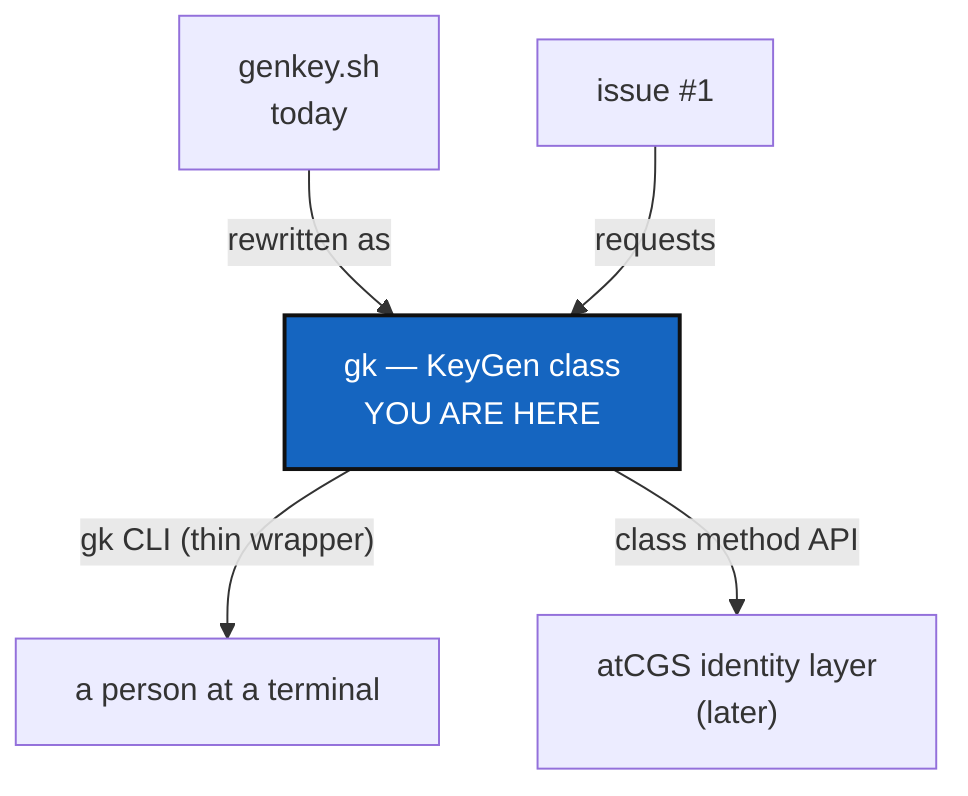

# KeyGenPackage — `gk`, a monolithic Python class with a passphrase-by-declaration

*Created: 2026-11-05*

*Branch: main*

*Source: GitHub issue [flipoyo/sshKeyGen#1](https://github.com/flipoyo/sshKeyGen/issues/1) — "ergonomy and security - KeyGen Python Package"*

## Abstract — read this first

**The one-line version.** Replace `genkey.sh` with one Python class, shipped as
the package `gk` under SemVer, whose methods other programs can call — and make
the private-key passphrase something the user *declares*, not something they
type into `ssh-keygen` each time.

**What this document is.** A ticket. Nothing here has been built.

**Why it exists.** Today sshKeyGen is a 300-line Bash script and a 190-line
README. Neither can be imported by another program, and the README mixes a
one-command tool with a general Git/SSH tutorial. The issue asks for two
things at once: a **UX** target (README of 100 lines at most, straightforward)
and a **SECURITY** target (the private key is protected by a passphrase derived
from a declared secret). The class is also meant to be absorbed later by
[atCGS](https://github.com/flipoyo/atCGS), which already owns an identity layer
(Argon2id, Ed25519, ssh keys held in a private agent).

**What you will find.** §1 what exists. §2 the target shape. §3 decisions —
the passphrase derivation is the one that matters. §4 work packages. §5
acceptance. §6 integration into atCGS.

**Who it is for.** Whoever implements it, and the owner, who answers §3.

**What you need to do with it.** Answer §3, then work §4 in order.



---

## 1. What exists

| Item | State |
|---|---|
| `genkey.sh EMAIL [PLATFORM] [HOSTNAME] [PROFILE]` | Generates `~/.ssh/id_ed25519[_platform][_host][_profile]`, adds it to ssh-agent, prints the public key and a config snippet |
| Platforms | `github`, `gitlab`, `codeberg` accepted; only `github` and `gitlab` get a config snippet and registration URL — codeberg falls into the generic branch |
| Passphrase | None set by the script; `ssh-keygen` prompts interactively, and an empty answer is accepted |
| Overwrite guard | Present: refuses if the key file exists |
| `README.md` | ~190 lines: the tool in two lines, then a general SSH/Git tutorial (config, agent, HTTPS→SSH, clone, push, failures) |
| Packaging, tests, version | None |

## 2. Target shape

**Name.** The issue says "Implement gk-SemVer": `gk` is the official command
name, versioned by Semantic Versioning (start at `0.1.0`).

**One monolithic class**, no module sprawl, so it can be vendored or imported
whole:

```python
from gk import KeyGen

kg = KeyGen(email="me@x.org", platform="github", hostname="laptop", profile="pro")
kg.key_path()          # Path, deterministic name, as today
kg.generate(secret)    # creates the pair, protected by the derived passphrase
kg.public_key()        # str
kg.ssh_config()        # str, snippet for the platform
kg.register_url()      # str, per platform
kg.load_into_agent(secret)
```

The `gk` command is a thin argument parser over these methods and holds no
logic of its own. File naming, platform table and permissions (700/600/644)
carry over unchanged from `genkey.sh`.

**UX contract.** `README.md` is at most 100 lines, user-oriented: install, one
command, register the key, test it. The general Git/SSH tutorial moves to
`docs/` and the README links to it.

**SECURITY contract.** The command is *decorated* with the declaration that the
key holds a private password: the user states a secret once, and
`sha256(secret)` is the private key's passphrase (see D1 before building this).

## 3. Decisions — your call

### D1. Is a bare `sha256(password)` acceptable as the passphrase?

The issue specifies it. It has three weaknesses, and the first is serious:

| Problem | Why it matters |
|---|---|
| SHA-256 is fast and unsalted | Anyone holding the private key file can test password guesses at billions per second, and the same password gives the same passphrase on every machine. The key's own bcrypt KDF only protects the *passphrase*, which here is itself a cheap function of a weak secret |
| Passphrase on the command line | `ssh-keygen -N <pass>` exposes it in `ps` and shell history |
| Hex digest as passphrase | Fine as a string, but adds no entropy the password did not already have |

| Option | What happens |
|---|---|
| **Argon2id(secret, salt) → passphrase** (recommended) | Same declared-secret UX; a slow, salted KDF. Matches the Argon2id identity key atCGS already derives, so the two compose rather than conflict |
| `sha256(secret)` exactly as written | Meets the issue literally; accept the weakness knowingly and document it in the README |
| `sha256` now, KDF selectable later | Ship `kdf = "sha256"` as a versioned parameter so moving to Argon2id is a minor release, not a break |

Whichever wins, the derivation is a named, versioned function in the class,
because anyone who regenerates the passphrase later needs the same one.

### D2. How does the passphrase reach `ssh-keygen`?

Never as an argument. Either `SSH_ASKPASS` with a private pipe/env, or generate
the OpenSSH key in-process and write it encrypted. The first keeps a single
runtime dependency on OpenSSH; the second adds a Python crypto dependency
(`cryptography`, plus `argon2-cffi` if D1 picks Argon2id).

### D3. Where does the secret come from?

Prompt with `getpass` by default; accept an environment variable or file
descriptor for scripted use (and for atCGS). Never a positional argument.
Confirm: is an empty secret an error? Recommendation: yes.

### D4. Fate of `genkey.sh`

Delete, or keep as a one-line shim calling `gk`. Recommendation: keep the shim
for one minor release, then remove.

### D5. Distribution

Package name `gk` may be taken on PyPI; check before promising `pipx install gk`.
Fallback names (`sshkeygen-gk`) keep the command `gk`.

## 4. Work packages

| WP | Depends on | Touches | Deliverable |
|---|---|---|---|
| **WP-K1** | D1, D2, D3 | — | Decisions recorded in this ticket |
| **WP-K2** | — | `pyproject.toml`, `src/gk/` | Package skeleton, `version = "0.1.0"`, console script `gk` |
| **WP-K3** | WP-K2 | `src/gk/keygen.py` | `KeyGen` class: naming, platform table (incl. codeberg snippet and URL), overwrite guard, permissions |
| **WP-K4** | WP-K1, WP-K3 | `src/gk/keygen.py` | Passphrase derivation per D1, delivery per D2, secret intake per D3, agent loading |
| **WP-K5** | WP-K3 | `src/gk/cli.py` | Thin CLI over the class; `gk --version` |
| **WP-K6** | WP-K3, WP-K4 | `tests/` | Tests in a temporary `$HOME`: naming, refusal to overwrite, 600/644 modes, key is encrypted, derivation vectors, secret never in argv |
| **WP-K7** | WP-K5 | `README.md`, `docs/` | README ≤ 100 lines; tutorial moved to `docs/ssh-git-guide.md` |
| **WP-K8** | WP-K5, D4 | `genkey.sh` | Shim or removal |

## 5. Acceptance

- `gk me@x.org github laptop pro` produces `~/.ssh/id_ed25519_github_laptop_pro`
  and `.pub`, exactly as `genkey.sh` did, and refuses to overwrite.
- The private key is encrypted; `ssh-keygen -y -f <key>` fails without the
  passphrase and succeeds with the derived one.
- The secret appears in no process argument list and no log output.
- `from gk import KeyGen` works in a clean environment and every §2 method is
  callable without a terminal.
- `wc -l README.md` ≤ 100, and the README alone takes a new user from install
  to a tested `ssh -T` connection.
- `gk --version` prints a SemVer string; tests pass.

## 6. Integration into atCGS (later, not in scope)

atCGS keeps users' ssh keys in a private agent and never in `~/.ssh`. The class
already separates *derive*, *generate* and *load*, so atCGS can call
`generate` with its own secret and a target directory, and skip the `~/.ssh`
side effects. That implies one parameter to reserve now: an optional
`ssh_dir` on `KeyGen`, defaulting to `~/.ssh`. Whether the passphrase scheme
should be shared with atCGS's Argon2id identity key is the real coupling —
settle it through D1 so the two do not diverge.

**Not in this ticket.** Key rotation, revocation, registering the key through
platform APIs, and any change to atCGS itself.
