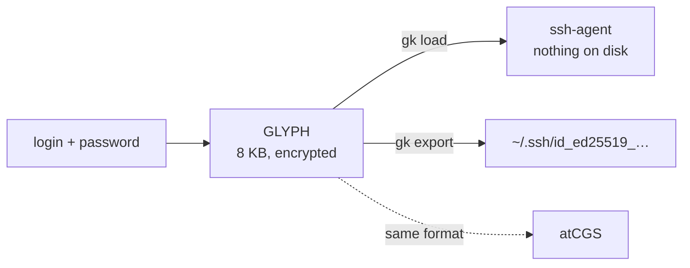

# gk v0.2.0

*Created: 2026-10-30*

One login and one password give you the same ssh identity on any machine. `gk` makes
named keys for GitHub, GitLab or Codeberg, keeps them in an encrypted file (the GLYPH),
and works with [atCGS](https://github.com/flipoyo/atCGS).



## 1. Install

Needs Python 3.11+ and OpenSSH. Anywhere: `pip install git+https://github.com/flipoyo/sshKeyGen`
(or `pipx`). Contributors use [Pixi](https://pixi.sh): `pixi install`, then `pixi run gk --help`.

## 2. Make a key

```bash
gk EMAIL [PLATFORM] [HOSTNAME] [PROFILE]     # gk me@x.org github laptop pro
```

`PLATFORM` is `github`, `gitlab` or `codeberg` (empty for a generic key). The key is named
`id_ed25519_github_laptop_pro`. `gk` asks for your password twice, then:

1. seals the key in your GLYPH (`~/.cgs/.glyph/<uid>.glyph`);
2. writes `~/.ssh/<key>` and `.pub`, as the old script did;
3. loads the key into your ssh-agent and prints the config snippet and the registration link.

Passwords need 16+ characters. Prefer your own key-file passphrase? Add `--own-passphrase`
(8+ characters, typed twice, never empty). Scripts: `--password-fd N`.

## 3. Tutorial: a machine you do not own

1. Bring your GLYPH file (8 KB) to `~/.cgs/.glyph/`, or make a new key with step 2.
2. `eval "$(ssh-agent -s)"`
3. `gk load me@x.org` puts your keys in the agent for an hour. Nothing is written to disk.
4. `ssh -T git@github.com`. When you leave, `ssh-add -D`.

## 4. Commands

| Command | Does |
|---|---|
| `gk EMAIL [PLATFORM] [HOST] [PROFILE]` | make a key (GLYPH, `~/.ssh`, agent) |
| `gk load EMAIL [NAME] [--lifetime S]` | GLYPH → agent, nothing on disk |
| `gk export EMAIL NAME` | GLYPH → `~/.ssh/NAME` |
| `gk passphrase EMAIL` | print the passphrase of exported key files (a secret) |
| `gk list EMAIL` | list the GLYPH's keys |

## 5. Good to know

- **Exported key files** are encrypted with a passphrase derived from your password.
  `ssh-add` will ask for it: use `gk load` or `gk passphrase`, or export with `--own-passphrase`.
- **The GLYPH is private.** Keep a copy, never put it in git. A stolen GLYPH is only as
  safe as your password; make it long.
- **Python API:** `from gk import KeyGen` ([ticket](.localSpec/DevTickets/openTickets/1-gk_1-1_KeyGenPackage_DevPlanTicket.md)).
- The old `./genkey.sh` still works for one release. The SSH/Git reference is in
  [docs/ssh-git-guide.md](docs/ssh-git-guide.md).

## Authorship

- AUTH: Nicolas Flipo

## LLM assistance

Parts of this project were written with the help of large language models,
used as a paid service under the author's direction. They are acknowledged
here rather than credited as co-authors on commits, merges or pull requests.

Main assistance:
- **Claude** (Anthropic) — Claude Code with Claude Sonnet 5.5

Responsibility for everything in this repository rests under the license terms.

## License

Distributed under the [MIT License](LICENSE): free to use, modify and
redistribute, provided as is, without warranty or liability.
